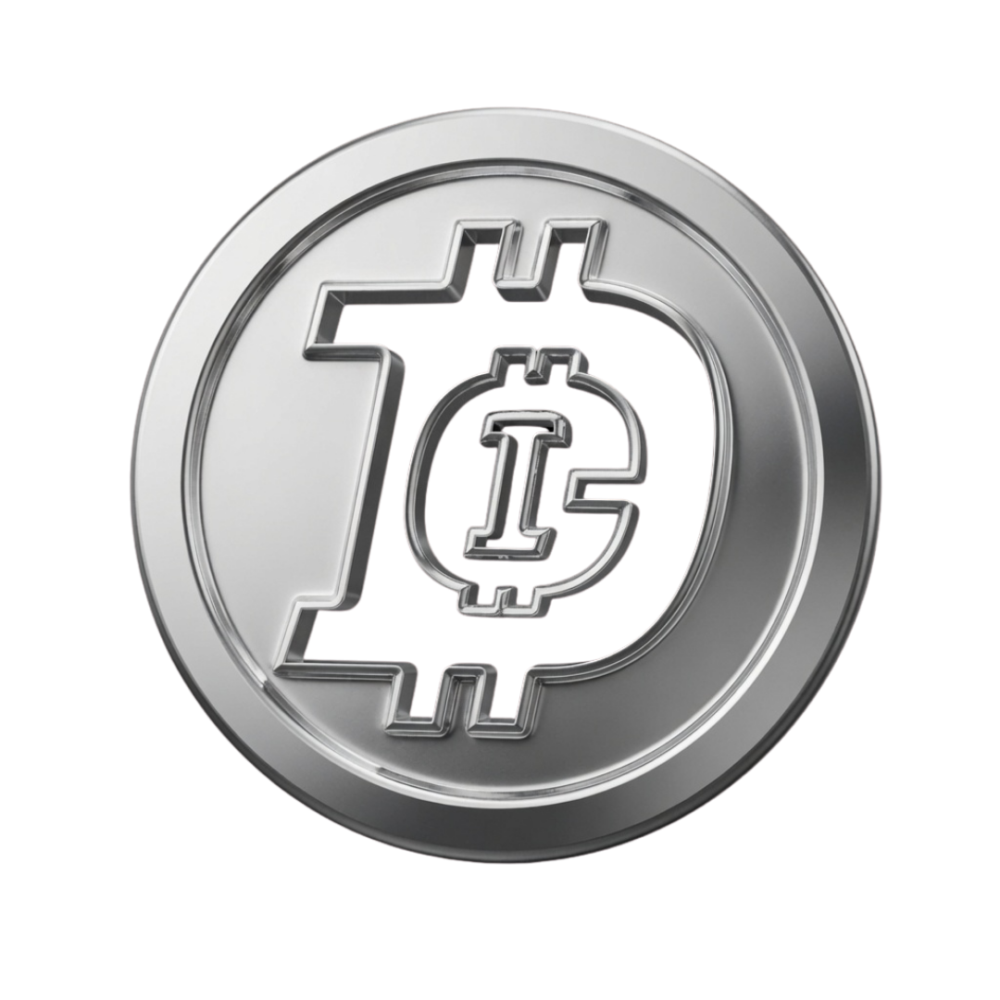
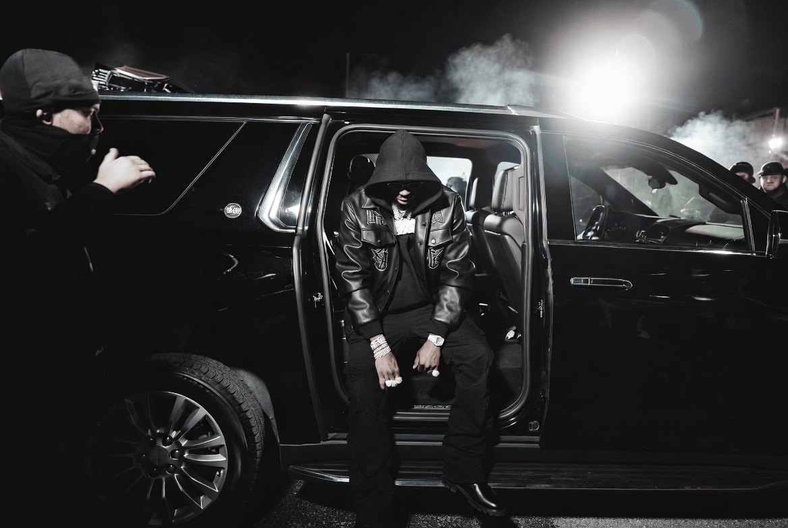
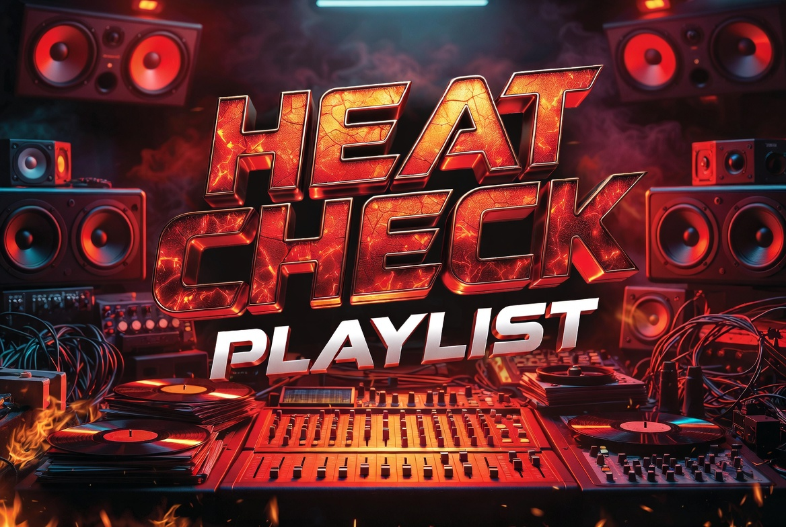
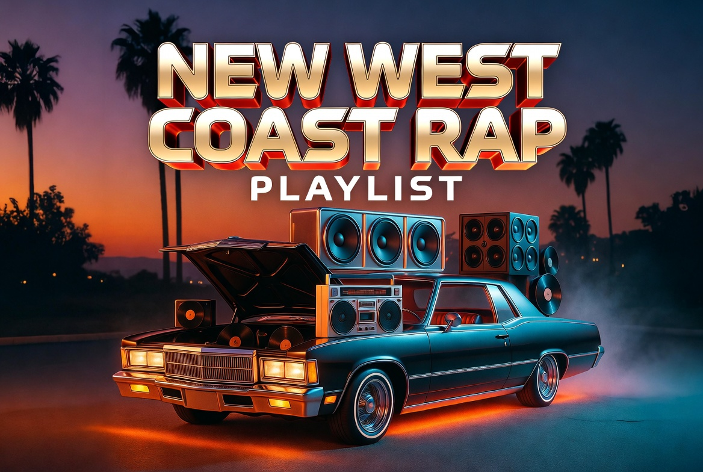
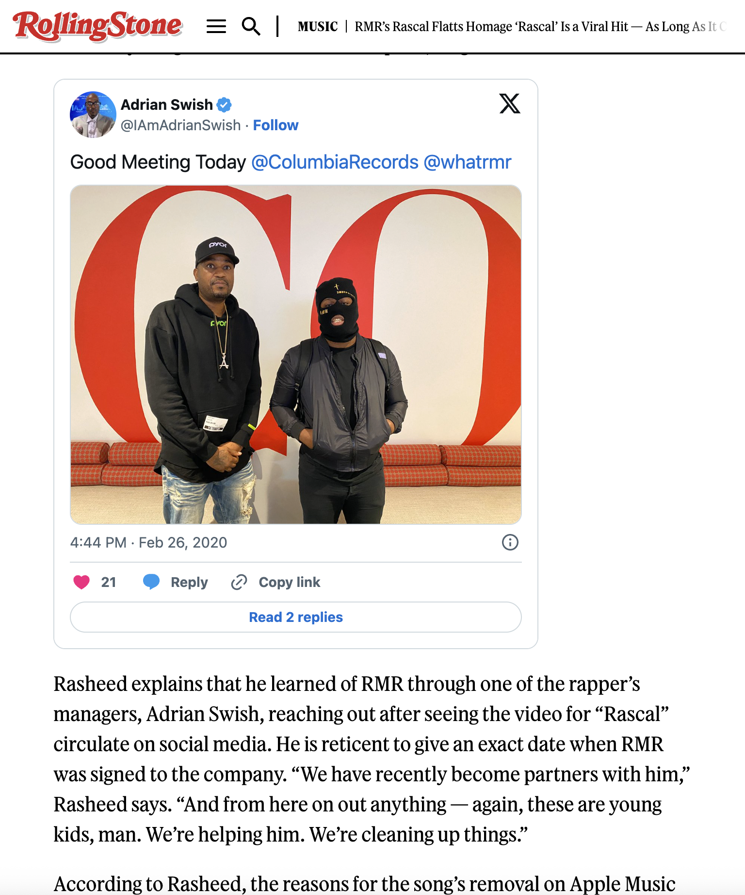

<p align="center">
  
</p>

<h1 align="center">Digital Currensy Inc.</h1>

<p align="center"><strong>Distribute. Market. Monetize. Scale.</strong></p>

<p align="center">
  Official website for an independent music distribution and label-services company.<br>
  No upfront distribution fee. Artists keep 80%.
</p>

<p align="center">
  <a href="https://www.digitalcurrensy.com"><strong>Live site</strong></a>
  &nbsp;·&nbsp;
  <a href="https://dci-website-two.vercel.app">Vercel preview</a>
  &nbsp;·&nbsp;
  <a href="https://dci.formberry.io/DigitalCurrensyInc-Questionnaire">Apply to distribute</a>
  &nbsp;·&nbsp;
  <a href="https://app.labeliq.ai">Label IQ AI</a>
</p>

---

## What this company does

Digital Currensy Inc. (DCI) helps independent artists, labels, and managers get music onto major platforms — then supports the release with marketing, royalties, playlists, sync prep, and AI tools.

This is **not** a crypto exchange and **not** an active token sale. It is a music-business platform founded in 2018 in Los Angeles.

**In one sentence:** you apply, DCI handles distribution and support, you keep 80% of revenue, DCI keeps 20% to run the infrastructure.

| You get | How it works |
| --- | --- |
| Global distribution | Audio + video to major platforms with clean files, metadata, ISRC &amp; UPC |
| No upfront fee | You do not pay to upload |
| 80 / 20 split | Artist 80%, DCI 20% |
| Royalties + splits | Payee invites, split setup, dashboard reporting |
| 30+ in-house playlists | Reviewed for fit — placement is never guaranteed |
| Marketing + campaigns | Press, social, and rollout planning |
| Sync prep | Clean versions, stems, credits, and rights notes for film / TV / brand |
| Label IQ AI | Connected AI music + video tools at [app.labeliq.ai](https://app.labeliq.ai) |
| DCI GPT | Assistant for release, royalty, playlist, and label questions |

Published results on the live site: **100M+ streams** · **$600K+** revenue across services · **800+** artists · **15K+** assets · **20K+** artist opt-in emails · **30+** playlists.

---

## Watch how it works

Official overview from the Digital Currensy Inc. channel:

[](https://www.youtube.com/watch?v=T4005q3Xi4I)

- Video: [Essential Guide — youtube.com/watch?v=T4005q3Xi4I](https://www.youtube.com/watch?v=T4005q3Xi4I)
- Channel: [youtube.com/@DigitalCurrensy](https://www.youtube.com/@DigitalCurrensy)
- Hero loop used on the site: [bg.mp4](https://github.com/DigitalCurrensy/dci-website/blob/main/bg.mp4)



Step-by-step walkthrough for artists and developers: **[docs/HOW_TO_USE.md](docs/HOW_TO_USE.md)**

---

## Platform screenshots

### Site navigation and apply flow

The live site is one cinematic page: proof stats, services, playlists, campaigns, press, then an apply CTA.


Top nav: About · Pricing · Services · Playlists · Sync · DCI GPT · Label IQ AI · Login · **Distribute Your Music**.


### Playlists

Artists can listen or submit. Fit is reviewed first. Placement is not guaranteed.


<p>
  
  
  
</p>

### Campaigns and press

DCI-backed work includes the RMR “Rascal” campaign. Coverage includes Rolling Stone and Influencive.





Sync and brand reach shown on the site includes PUMA, FOX Sports, VH1, MTV, BET, and ESPN.


---

## How to use the platform

Full walkthrough: **[docs/HOW_TO_USE.md](docs/HOW_TO_USE.md)**

1. Open [digitalcurrensy.com](https://www.digitalcurrensy.com).
2. Read the services. Optional: use DCI GPT on the site or open [Label IQ AI](https://app.labeliq.ai).
3. Apply with the [artist questionnaire](https://dci.formberry.io/DigitalCurrensyInc-Questionnaire).
4. Have ready: WAV/AIFF master, cover art, metadata (title, writers, producers, splits), plus a clean version and instrumental if you want sync.
5. DCI reviews the application. If accepted, they set up distribution, splits, and support.
6. After release: reporting, playlist review, and campaign support as scoped.
7. Questions: [info@digitalcurrensy.com](mailto:info@digitalcurrensy.com).

Playlist submit and sync review do **not** guarantee placement.

---

## What this repository is

This repo is the **V2 static website** for Digital Currensy Inc.

| Surface | URL | Role |
| --- | --- | --- |
| Production | [digitalcurrensy.com](https://www.digitalcurrensy.com) | Live public site |
| This repo preview | [dci-website-two.vercel.app](https://dci-website-two.vercel.app) | Vercel deploy of this repo |
| Apply | [Formberry questionnaire](https://dci.formberry.io/DigitalCurrensyInc-Questionnaire) | Intake form (not in this repo) |
| Label IQ AI | [app.labeliq.ai](https://app.labeliq.ai) | Separate product |

Active site files: `index.html`, `assets/`, `bg.mp4`, `bg.webm`, `dci-logo.png`, `whitepaper.pdf`.

`_live-site-reference/` is a **read-only** snapshot of an older Next.js multi-page site. Do not treat it as the live app.

`whitepaper.pdf` is **historical brand context**. Do not present it as an active ICO, investment product, or token sale.

File map and deploy notes: **[docs/ARCHITECTURE.md](docs/ARCHITECTURE.md)**

---

## Run it locally

```bash
git clone https://github.com/DigitalCurrensy/dci-website.git
cd dci-website
npm start
# or: python3 -m http.server 3000
# open http://localhost:3000
```

No Node build is required. `package.json` scripts exist so Vercel does not try to compile Next.js.

`vercel.json` serves the repo root as a static site.

---

## Edit rules

1. Do not change production DNS from this repo without an explicit cutover plan.
2. Do not delete or rewrite `_live-site-reference/` — it is the SEO and route archive.
3. Keep the primary CTAs: Distribute / Get Invite, DCI GPT, Label IQ AI, Login.
4. Do not add live token-sale or investment claims.
5. Edit `index.html` and `assets/` for V2. Keep the backup copies (`index.backup-before-final-fix.html`, `formatted.html`).

More detail: **[CONTRIBUTING.md](CONTRIBUTING.md)**

---

## Related repos

- [DCI-WHITEPAPER](https://github.com/DigitalCurrensy/DCI-WHITEPAPER) — historical company thesis. Not a live settlement rail.
- [LABEL-IQ-WHITEPAPER](https://github.com/DigitalCurrensy/LABEL-IQ-WHITEPAPER) — historical Label IQ paper. Not the live AI studio.

---

## Contact

- Site: [digitalcurrensy.com](https://www.digitalcurrensy.com)
- Email: [info@digitalcurrensy.com](mailto:info@digitalcurrensy.com)
- X / Instagram: [@DigitalCurrensy](https://x.com/DigitalCurrensy)
- Los Angeles

DCI does not provide financial, legal, or investment advice.
